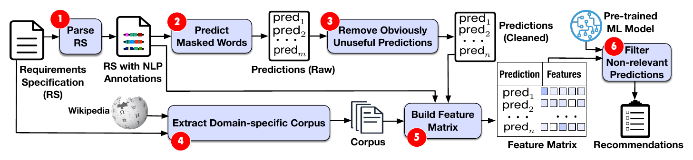

# Introduction
This repository contains the implementation and evaluation artifacts for the REFSQ 2023 submission titled "Using Language Models for Enhancing the Completeness of Natural-language Requirements", authored by Dipeeka Luitel, Shabnam Hassani and Mehrdad Sabetzadeh.

International Working Conference on Requirements Engineering: Foundation for Software Quality (REFSQ 2023), pages 87-104. [Paper (DOI)](https://doi.org/10.1007/978-3-031-29786-1_7) · [arXiv](https://arxiv.org/abs/2302.04792)

## Overview



Fig. 2 from the paper: approach overview.

# Prerequisites
- Python 3.8
- SpaCy 3.2.2
- PyTorch1.10.2+cu113
- GloVe (https://nlp.stanford.edu/projects/glove/) 
- Transformers 4.16.2 library by Hugging Face (https://huggingface.co/)
- WEKA 3-8-5 (https://www.cs.waikato.ac.nz/ml/weka/)


# Instructions
The following steps explain how to use this repository to utilize BERT's MLM for assisting with completeness checking of requirements. The code has been streamlined to simplify the process of filtering relevant predicted terms, generated by BERT, for a supplied RS.
1. Run RQ1_Script.py using the provided documents (or with a requirements specification). This runs BERT's MLM and generates a raw set of predictions, a feature matrix (.ARFF file), and a summary table for metrics.
2. Load WEKA and create a new Explorer project.
3. In the Classify tab: 
    - Unzip and load P1 Model corresponding to desired filtering level (strict, moderate, and lenient).  
    - Set .ARFF file (generated in Step 1) as the supplied test set.
4. Click "More options..." and select "CSV" under "Output predictions".
5. Select "Re-evaluate model on current test set".
6. Copy output of "Predictions on user test set" into new CSV file.
7. Predictions marked True correspond to relevant predictions in the raw predictions file (Step 1 above). These predictions, after duplicate removal, constitute the final reccommendations made to the user.

## Citation

```bibtex
@inproceedings{Luitel_2023,
  title     = {Using Language Models for Enhancing the Completeness of Natural-Language Requirements},
  author    = {Luitel, Dipeeka and Hassani, Shabnam and Sabetzadeh, Mehrdad},
  booktitle = {Requirements Engineering: Foundation for Software Quality},
  pages     = {87--104},
  year      = {2023},
  publisher = {Springer Nature Switzerland},
  doi       = {10.1007/978-3-031-29786-1_7}
}
```
